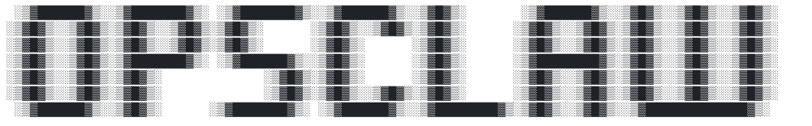

OpsClaw is a self-hosted SRE agent for one operations team. It continuously
checks infrastructure, investigates alerts, proposes or performs remediation
within explicit policy, and keeps the evidence needed to understand what it
did.

It runs as a daemon beside the systems it watches, not as a SaaS service. The
daemon provides an installable web UI, an operator CLI, optional Telegram and
webhook channels, durable SQLite state, and team memory through Hindsight.

## What it does

- Schedules proactive scans and correlates findings into incidents.
- Operates across SSH, local, and Kubernetes targets, with typed access to
  service resources.
- Applies autonomy per project, environment, or target: `observe`, `suggest`,
  `act_on_known`, or `auto`.
- Queues risky changes with the exact command and context needed for approval.
- Routes every target command through one policy choke point with e-stop,
  cost, rate, scope, and audit enforcement.
- Records a tamper-evident audit chain and produces incident postmortems.
- Gives the team a shared `Operations` chat and a durable conversation per
  project environment. Environment chat is also a tool-authorization boundary.
- Tracks combined OpsClaw and Hindsight LLM spend against a daily cap.

## Standard installation

The supported standard install is Docker Compose. It runs OpsClaw with the
pinned Hindsight memory service and stores config, SQLite data, memory, and
prepared target credentials in named volumes.

Requirements: Docker with Compose, an OpenRouter API key, and a host from
which the intended targets are reachable.

```sh
git clone https://github.com/DCPRevere/opsclaw.git
cd opsclaw
cp deploy/.env.example deploy/.env
mkdir -p deploy/creds
$EDITOR deploy/.env
```

Set `HINDSIGHT_LLM_API_KEY`, `OPENROUTER_API_KEY`, and `OPSCLAW_MODELS` in
`deploy/.env`. Pin `OPSCLAW_VERSION` to a release tag for production.

Onboard before starting the daemon. A fresh daemon cannot boot in live mode
until onboarding has generated its gateway secret.

```sh
docker compose -f deploy/docker-compose.yml --env-file deploy/.env \
  run --rm --no-deps opsclaw-daemon \
  opsclaw-cli onboard --hindsight-url http://opsclaw-hindsight:8888

docker compose -f deploy/docker-compose.yml --env-file deploy/.env up -d

docker compose -f deploy/docker-compose.yml --env-file deploy/.env \
  exec opsclaw-daemon opsclaw-cli doctor
```

Hindsight can take roughly 40 seconds to become ready on its first start. If
`doctor` reports only Hindsight as unavailable, wait and run it again.

The web UI listens on `http://127.0.0.1:8484`. Keep it private: use localhost,
a VPN/tailnet, an SSH tunnel, or a TLS reverse proxy. Do not expose the daemon
directly to the public internet.

### Target credentials

Place host-provided credentials in `deploy/creds/`. The Compose credential
initializer copies them into a private volume, assigns the daemon UID, and
applies restrictive modes. Reference the resulting path as
`/home/opsclaw/creds/<name>` while adding a target.

```sh
docker compose -f deploy/docker-compose.yml --env-file deploy/.env \
  exec opsclaw-daemon opsclaw-cli config projects add
```

A `local` target in Docker means the OpsClaw container, not the Docker host.
Use SSH when the host itself is the intended target.

## Operating model

Configuration follows this hierarchy:

```text
Project
└── Environment
    └── Target
        └── Resource
```

Policy attributes inherit down the hierarchy; credentials never do. A target
is one connection and audit identity such as `shop::prod::api`. Resources add
service-specific access such as PostgreSQL, Prometheus, Argo CD, RabbitMQ, or
Elasticsearch without weakening the owning target boundary.

Team chat follows the same model:

- `Operations` is the global coordination conversation and cannot invoke
  target tools.
- Each project environment has a shared conversation whose transcript and
  tools are restricted to that environment.
- Every operator sees the same history and can continue another operator's
  work. There are no private operator transcripts.

The CLI selects an environment conversation explicitly:

```sh
opsclaw-cli chat --remote --conversation shop::prod
opsclaw-cli chat --remote --conversation shop::prod --history
```

## Safety

OpsClaw treats model output as a proposal, never as authority. Tool arguments
are resolved against configured targets, command risk is classified in code,
and target execution is reachable only through policy enforcement.

Useful controls:

```sh
opsclaw-cli estop                         # local, works if the daemon is wedged
opsclaw-cli approvals list               # inspect exact queued commands
opsclaw-cli blocked-actions              # mutations refused in observe mode
opsclaw-cli audit verify                 # verify the audit chain
opsclaw-cli usage                        # spend, cap, and remaining headroom
opsclaw-cli status                       # remote daemon and active-turn status
```

Start new targets at `observe`, inspect `blocked-actions`, then promote their
autonomy deliberately. Use dedicated, least-privilege credentials that can be
revoked without affecting a human operator.

## Common commands

```sh
opsclaw-cli doctor
opsclaw-cli config list
opsclaw-cli incidents list
opsclaw-cli incidents ack <id>
opsclaw-cli incidents resolve <id>
opsclaw-cli jobs list
opsclaw-cli scan project::env::target
opsclaw-cli postmortem <incident-id>
opsclaw-cli completions zsh
```

Run `opsclaw-cli --help` or `opsclaw-cli <command> --help` for the complete
surface. Commands label themselves `[local]`, `[remote]`, or `[local|remote]`.

## Build and test

OpsClaw requires Rust 1.94 or newer.

```sh
cargo build --release --locked
cargo test
cargo clippy --all-targets --all-features -- -D warnings
```

The two binaries are `target/release/opsclaw` and
`target/release/opsclaw-cli`. A bare-binary deployment must provide its own
reachable Hindsight service through `HINDSIGHT_URL`.

The repository parity suite tests every persistence contract against both the
in-memory implementation and SQLite. Browser journeys live in `web-tests/`;
live model evaluations are opt-in through `just evals` because they spend
tokens.

## Further reading

- [Architecture and invariants](docs/DESIGN.md)
- [Sandboxed evaluation setup](docs/SANDBOX.md)
- [Operator-facing changes](CHANGELOG.md)
- [Project brief](OPSCLAW_BRIEF.md)
